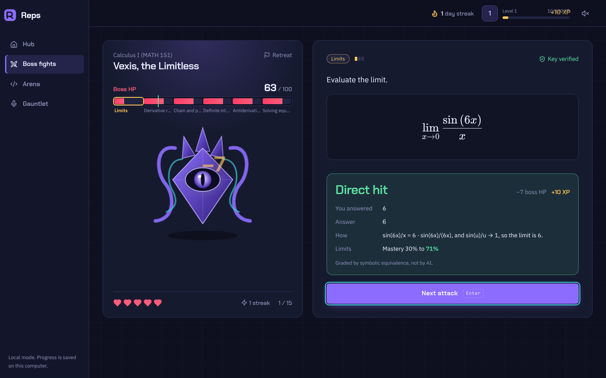
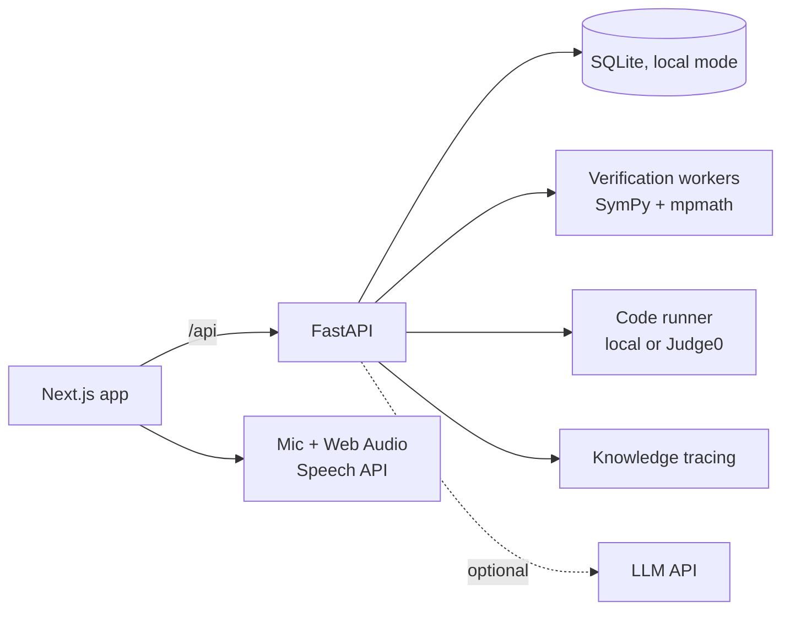

# Reps

One training ground for college students: fight bosses built from your courses, solve coding problems in the Arena, and run mock interviews in the Gauntlet. KTP technical capstone, CS / ITI track.

Wherever an answer can be checked by running something, Reps checks it that way. The AI explains results; it doesn't decide them.



## Run it

**Windows:** install [Python 3.11+](https://www.python.org/downloads/) (tick "Add to PATH") and [Node.js 20+](https://nodejs.org/), then double-click `start-reps.bat`. The first run installs everything; after that it opens two windows (API and web) and your browser at http://localhost:3000.

**macOS / Linux:** `./start-reps.sh`

Use Chrome or Edge for voice interviews. Everything else works in any modern browser. Progress is saved locally in `apps/api/data/reps.db`.

Optional: copy `.env.example` to `.env` and set `LLM_API_KEY` and `LLM_MODEL` to turn on question generation from your own PDFs and AI STAR scoring in interviews.

## The three modes

| Mode | What you do | What's checked, and how |
| --- | --- | --- |
| Boss fights | Answer questions; correct answers damage the boss, wrong ones cost a heart | Every answer key is computed twice (SymPy symbolic and mpmath numeric) before you see the question; your answer is checked by symbolic equivalence |
| Arena | Solve original Python problems by pattern | Your code runs against public and hidden tests; each problem passed reference vs brute-force checks on 300+ random inputs before publishing |
| Gauntlet | Answer behavioral, resume, and coding questions out loud or typed | Pace and pauses measured from microphone audio levels; filler words and structure counted from the transcript; code run against tests; STAR scores only with an AI key, labeled as AI judgment |

### Game rules

- **Boss HP** = 100 × (1 − average mastery) across the course's topics. The HP bar has one segment per topic, so the long red segments are your weak topics.
- **Mastery** is a Bayesian Knowledge Tracing estimate per topic, updated after every graded answer and kept between fights.
- **Win** by getting the boss to 25 HP or less (75% average mastery). **Lose** if your 5 hearts run out. A fight is at most 15 questions.
- **Targeting:** the boss asks every topic once, then mostly attacks your weakest topic, but never the same one more than twice in a row. Question difficulty follows your mastery.
- **XP** comes only from confirmed events (verified correct answers, accepted solutions, finished sessions) and each event pays once. XP is motivation, not a grade.

## Architecture



The hosted version swaps SQLite for Supabase: the schema and row level security policies are in `supabase/migrations` and tested in CI.

## Components (track requirements)

| Component | Category | Where |
| --- | --- | --- |
| PDF parsing into page-cited chunks, resume claim extraction | File processing | `reps_api/ingest`, `reps_api/interview.py` |
| Question generation from your notes, AI STAR scoring | AI / NLP | `reps_api/generation.py`, `reps_api/llm.py` |
| Answer-key verification, differential testing, code execution | Algorithm + external API | `reps_api/verification` |
| Bayesian Knowledge Tracing and the boss policy | Machine learning | `reps_api/tutor`, `eval/assistments_bkt.py` |
| Live voice: transcript, audio-level pause detection, spoken questions | Real-time | `apps/web/lib/voice.ts` |
| Course generation jobs with persisted progress | Background jobs | `reps_api/generation.py` |

## Tests

```bash
cd apps/api && pytest -q                                  # 115 backend tests
python eval/assistments_bkt.py --synthetic                # BKT evaluation pipeline self-check
cd ../web && npm run typecheck && npm run build
REPS_DB_PATH=../api/data/reps.db python e2e/playthrough.py   # browser playthrough of all three modes
```

The database tests run the Supabase migration on plain Postgres with row level security checks (see `.github/workflows/ci.yml`).

## Known limitations

- **Local runner isn't a sandbox.** On Linux/macOS it limits CPU and memory; on Windows only time. It doesn't block network access. Production must use Judge0 (`JUDGE0_URL`), and the API refuses the local runner when `REPS_ENV=production`.
- **Windows support is written but tested only on Linux so far.** The Windows-specific code path (no resource limits) is covered by a test that forces it.
- **Voice** depends on the browser's speech recognition (Chrome, Edge). It often drops "um" and "uh", so filler counts run low. Pause and pace numbers come from audio levels and don't depend on it. Voice hasn't been tested automatically; the e2e test types its answers.
- **Built-in courses** cover Calculus I and kinematics. Your own courses need an AI key, and only computational questions are generated so far.
- **Resume claims** are found with simple rules (bullets and numbers), not AI.
- **BKT parameters** are defaults; the ASSISTments evaluation hasn't been run on real data yet.
- **Single player, no login** in local mode. Supabase auth arrives with the hosted version.

## Next

Phone layout polish, Supabase auth and hosting, Judge0, conceptual (non-computational) questions with rubric grading, more Arena problems and languages.
