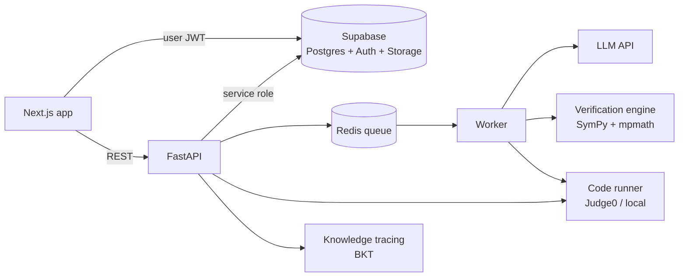

# Reps

Study any class, grind coding problems, and run mock interviews built from your resume, all as one game. KTP technical capstone, CS / ITI track.

Wherever an answer can be checked by running something, Reps checks it that way. The AI explains results; it doesn't decide them.

## Status

| Area | State |
| --- | --- |
| Math answer-key verification (SymPy + independent mpmath check) | Built, tested |
| Student math grading (equivalent forms accepted) | Built, tested |
| Coding verification (reference vs brute force, 300+ seeded inputs) | Built, tested |
| Coding grading (public + hidden tests, verdicts) | Built, tested on local runner; Judge0 adapter tested with a mock only |
| Bayesian Knowledge Tracing + boss targeting | Built, tested |
| BKT evaluation pipeline | Built, checked on synthetic data. **Not yet run on ASSISTments** |
| PDF extraction and chunking | Built, tested |
| Database schema + row level security | Built, tested on local Postgres. **Not yet applied to Supabase** |
| LLM adapter, question generation, topic extraction | Not started |
| Background worker (Redis) | Not started |
| Frontend (Next.js) | Not started |
| Interview mode, voice | Not started |

## Architecture



The browser reads its own rows directly from Supabase under row level security. Anything that decides correctness (questions, answer keys, attempts, mastery, XP) is written only by the backend.

## How verification works

**Math.** A generated problem is a template plus a declarative task (`derivative`, `integral_definite`, `solve`, `limit`, ...), never runnable code. For each instance the engine computes the answer symbolically with SymPy and again numerically with mpmath at 30 digits (numerical differentiation, quadrature, a root scan over [-100, 100], approach-the-point limits). If the generator supplied its own key, that's a third check. Any disagreement rejects the problem. Expressions pass through a whitelist parser, so `__import__` and friends never reach `eval`.

**Code.** Each problem ships a reference solution, a brute-force solution, and a seeded input generator. The two solutions must differ structurally (checked on the syntax tree with names normalized, so a renamed copy fails) and agree on every edge case plus 300 random inputs. Hidden test outputs come from the verified reference. Student code runs in the sandbox on inputs only; expected outputs never enter it, and the backend does the comparison, so student code can't read or forge results.

**Knowledge tracing.** Standard BKT per topic. Boss HP = 100 × (1 − mean P(known)) across the exam's topics. The boss covers every topic once, explores 15% of the time, and otherwise attacks the weakest topic, but never the same one more than twice in a row. Default parameters are starting values, not fitted ones.

## Repository

```
apps/api/            FastAPI backend
  reps_api/verification/  math engine, coding engine, sandbox harness, executors
  reps_api/tutor/         knowledge tracing
  reps_api/ingest/        PDF extraction
  reps_api/content/       verified seed coding problems
  eval/                   BKT evaluation (ASSISTments)
  tests/
supabase/migrations/  schema and RLS
supabase/tests/       RLS tests (run on plain Postgres with a small Supabase shim)
```

## Setup

Requires Python 3.11+ and (for the DB tests) PostgreSQL 16.

```bash
cd apps/api
pip install -e ".[dev]"
pytest -q                                  # 91 tests
python eval/assistments_bkt.py --synthetic # evaluation pipeline self-check
INTERNAL_API_TOKEN=dev uvicorn reps_api.main:app --reload
```

Database tests:

```bash
createdb reps_test
psql -v ON_ERROR_STOP=1 -d reps_test \
  -f supabase/tests/supabase_shim.sql \
  -f supabase/migrations/20261012000100_core.sql \
  -f supabase/tests/rls_test.sql
```

Copy `.env.example` to `.env` for configuration.

## Known limitations

- The local code runner is a resource-limited subprocess, not a security sandbox (no network isolation). Production must set `JUDGE0_URL`; the app refuses to start the local runner when `REPS_ENV=production`.
- Only Python submissions for now.
- Math verification covers single-variable calculus and algebra tasks. Anything else is marked `unsupported` and never published as verified.
- Root finding only searches [-100, 100]; problems with roots outside are marked unsupported.
- Scanned PDFs are refused until OCR is added.
- BKT parameters are defaults until the ASSISTments evaluation is run.

## Future improvements

LLM question generation with grounding citations, Redis worker, Next.js app, interview mode with voice, OCR, C++ and Java through Judge0.
